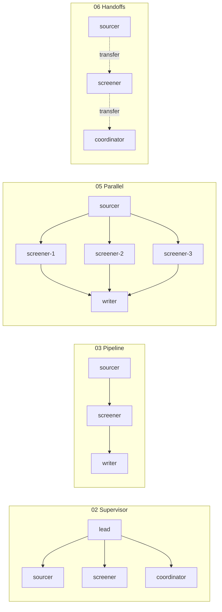

# Multi-Agent Lab

**Run 8 multi-agent patterns on one small hiring problem, and watch every agent work.**

Each pattern is one short Python file. Run it, see a live, coloured trace in your terminal, then open an
HTML timeline that replays the run step by step: who did what, who asked whom, and what it cost.
Everything runs **offline with no API key** first (a scripted fake model), then with a real model by
changing one line.

By Mohammad Kabajah · companion to the [agents-workshop](https://github.com/mkabajah/agents-workshop) (Session 2).

```
python mas.py run 02
```
```
➜ code         code → lead: Shortlist Kafka candidates, check the evidence, and book the best one
▶ lead         Shortlist Kafka candidates, check the evidence, and book the best one
➜ lead         lead → sourcer: Find every candidate with: kafka.
   ▶ sourcer      Find every candidate with: kafka.
   🔧 sourcer      find_candidates({'skill': 'kafka', 'city': ''})
   ✔ sourcer      Found: cand-006.md, cand-007.md, cand-009.md.
➜ lead         lead → screener: Check the evidence for kafka in cand-006.md, cand-007.md, cand-009.md.
   ▶ screener     ...
➜ lead         lead → coordinator: Book an interview for cand-006.md for the backend-engineer job.
   🔧 coordinator  schedule_interview({'cv': 'cand-006.md', 'job': 'backend-engineer', 'slot': 'Mon 11:00'})
✔ lead         ...

agents: 4 · model calls: 13 · tool calls: 6 · 0.1s
timeline: open runs/latest.html
```

---

## Start in 3 minutes

```bash
git clone https://github.com/mkabajah/multi-agent-lab && cd multi-agent-lab
python3.12 -m venv .venv && source .venv/bin/activate      # Windows: .venv\Scripts\activate
pip install -r requirements.txt
cp .env.example .env                                       # MODEL=fake: no key needed
python check_setup.py                                      # ✔ ✔ ✔ … tells you what to fix
python mas.py list
```

Then:

| Command | What it does |
|---|---|
| `python mas.py list` | the 8 patterns, one line each |
| `python mas.py explain 02` | what pattern 02 is, when to use it, what to watch for |
| `python mas.py run 02` | run it with its example question |
| `python mas.py run 02 "your own question"` | run it on your question |
| `python mas.py compare` | run **all** patterns on one question and compare the cost |
| open `runs/latest.html` | replay the last run in your browser (▶ Replay, or the → key) |

Python 3.10–3.13 (3.12 recommended). Add `--auto` to approve human-approval steps automatically,
`--quiet` to hide the live trace.

---

## The problem every pattern solves

A small company is hiring. It has invented CVs (`data/cvs/`) behind an **MCP server**
(`cv_server/`) with four tools, plus two "action" tools that write to `outbox/` instead of a real calendar:

| Tool | Does |
|---|---|
| `find_candidates(skill, city)` | every CV with that skill |
| `search_cvs(question)` | the most relevant CV passages |
| `get_cv(file_name)` | one whole CV (contacts removed) |
| `list_jobs()` | the open positions |
| `get_free_slots()` · `schedule_interview(cv, job, slot)` | book an interview (mock) |

And a small team of specialist agents (`lab/team.py`), each with **only its own tools**:

| Agent | Tools | Job |
|---|---|---|
| **sourcer** | find_candidates, search_cvs | who has the skills? |
| **screener** | get_cv, search_cvs | is the evidence real? |
| **coordinator** | get_free_slots, schedule_interview | book it |
| **writer** | none | write the final answer |
| **critic** | none | is the answer good enough? |
| **router** | none | who should handle this? |

The patterns differ only in **how these agents are connected**. Same agents, same tools, same question:
that's what makes them easy to compare.

---

## The 8 patterns

| # | Pattern | Who decides what happens next? | Use it when |
|---|---|---|---|
| 01 | **One agent** (baseline) | the one agent | the task is small; always try this first |
| 02 | **Supervisor** (agents as tools) | a lead agent | steps vary per request; one agent in charge |
| 03 | **Pipeline** | your code, fixed order | the steps are always the same |
| 04 | **Router** | a classifier, once | requests fall into a few clear kinds |
| 05 | **Parallel fan-out** | your code, all at once | independent pieces (one CV each) |
| 06 | **Handoffs** (swarm) | the agent in charge passes the baton | work flows from expert to expert |
| 07 | **Writer + critic** | a review loop | quality matters more than speed |
| 08 | **Supervisor + human approval** | the lead, but a person approves | an agent can change the world |



Every pattern file starts with a diagram and four lines: **The idea · Use it when · Watch for · Try**.
Read [docs/patterns.md](docs/patterns.md) for all eight on one page, with the key lines of code.

---

## Learning path (about 2 hours)

1. **Read** [docs/00-what-is-a-multi-agent-system.md](docs/00-what-is-a-multi-agent-system.md) (10 min).
2. **Run** `python mas.py run 01`, then `02`. Open `runs/latest.html` after each. What changed? (15 min)
3. **Run** 03 → 08 and read each file in `patterns/`. They are 15–45 lines each. (45 min)
4. **Compare:** `python mas.py compare`. Which pattern is cheapest for this question? Why? (10 min)
5. **Switch to a real model** (below) and run 02 and 06 again: now the model, not the script, decides. (15 min)
6. **Do the exercises** in [docs/exercises.md](docs/exercises.md). (30+ min)

Stuck reading a trace? → [docs/reading-a-trace.md](docs/reading-a-trace.md).
Want to know how the lab itself works? → [docs/how-it-works.md](docs/how-it-works.md).

---

## Use a real model

Edit `.env` (see `.env.example` for all options):

```bash
MODEL=openai:gpt-4o-mini            # + OPENAI_API_KEY
MODEL=anthropic:claude-sonnet-4-6   # + ANTHROPIC_API_KEY
MODEL=openai:openai/gpt-oss-20b     # free tier on Groq: + OPENAI_BASE_URL=https://api.groq.com/openai/v1
MODEL=ollama:qwen2.5:7b             # local and free: pip install langchain-ollama
```

> **The fake model is not an LLM.** It follows simple rules (`lab/models.py`) so you can see the
> *mechanics* for free. Its answers are marked `(fake)`. With a real model, the agents decide on their
> own, so runs differ, and sometimes a pattern goes wrong: that's what you're here to see.

---

## What's in the repo

```
mas.py               the command line: list · explain · run · compare
patterns/            ★ the 8 patterns, one file each (start here)
lab/
  team.py            the specialist agents + team.ask() = run one agent, traced
  prompts.py         one system prompt per role
  trace.py           records every event under the agent that did it (live trace)
  viewer.py          writes the HTML timeline (runs/*.html)
  models.py          MODEL=... → a chat model, or the offline fake model
  mcp_tools.py       connects to the CV MCP server
  actions.py         mock write tools (book, email) → outbox/
  config.py          settings from .env
cv_server/           the MCP server with the CV search tools
data/                invented CVs and job posts
docs/                the explanations
tests/               every pattern, offline (pytest)
check_setup.py       is my laptop ready?
```

Run the tests: `python -m pytest -q` (offline, ~10 seconds).

---

## Built with

[LangChain 1.x](https://docs.langchain.com/oss/python/langchain/overview) `create_agent` and middleware ·
[LangGraph](https://docs.langchain.com/oss/python/langgraph/overview) checkpointers and interrupts ·
[MCP](https://modelcontextprotocol.io) via `langchain-mcp-adapters`. The same patterns exist in other
frameworks (Strands, CrewAI, OpenAI Agents SDK, AutoGen); see the
[agents-workshop](https://github.com/mkabajah/agents-workshop) for Strands and CrewAI versions.

MIT licensed. The CVs are invented.
